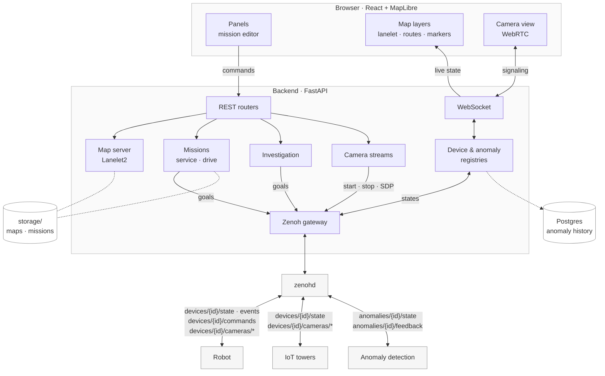
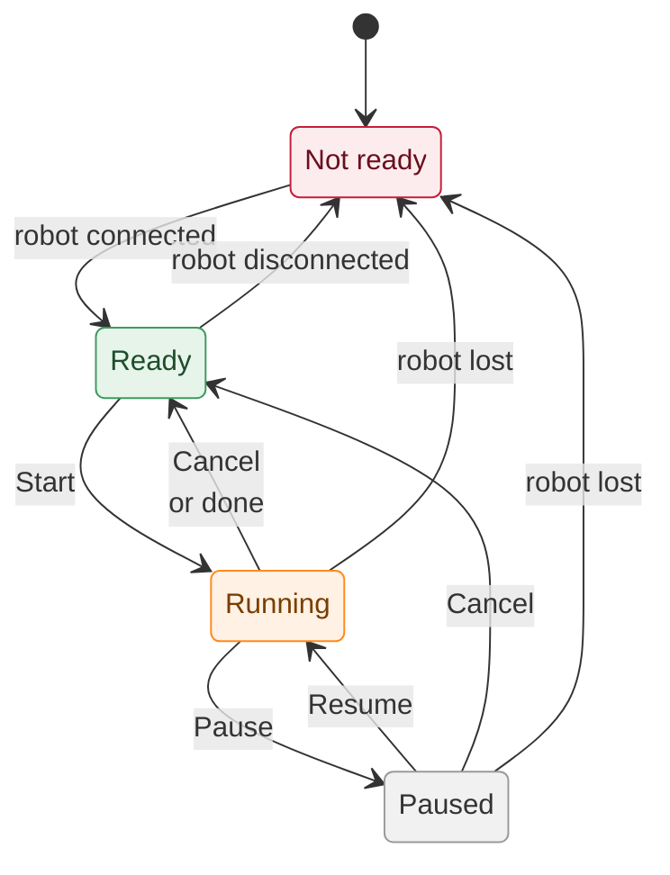
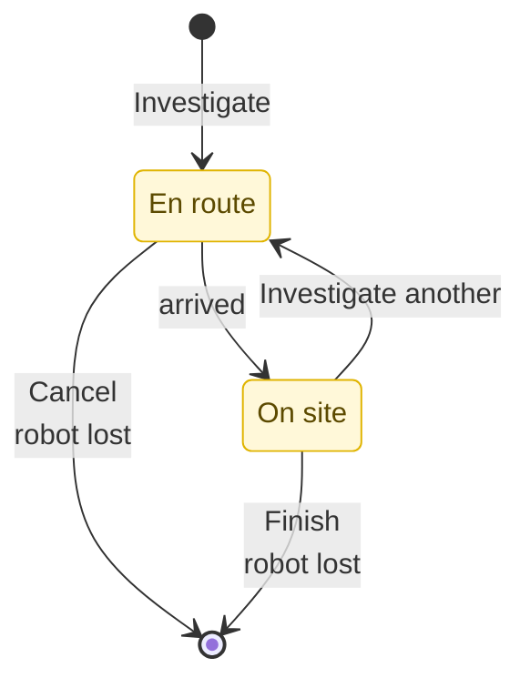

# Mission Manager

Mission Manager is the operator console for the `husky` patrol robot. It shows a live map built from the site's Lanelet2 road network. The map shows where the robot and the IoT towers are, what each tower camera can see, and the anomalies those towers detect. Operators draw patrol missions on the map. Each waypoint snaps onto a lane, and the route between waypoints follows the lanelet graph. A mission can repeat a fixed number of times or loop forever. Operators can start, pause, resume and cancel it from the UI, while the backend sends the robot one goal at a time. When a tower reports an anomaly, the operator can pull the robot off its route to investigate it. The operator watches the camera feeds, records a verdict and sends it back to the anomaly detector, and the robot then returns to its mission. The backend is FastAPI and the frontend is React with MapLibre. Robots, towers and the anomaly detector communicate over Zenoh. Everything runs under Docker Compose.

## Quick start

```bash
docker compose up --build
```

Then open <http://localhost:5050>. Use `--build` again whenever the source code changes. Compose starts four services. The **frontend** is nginx serving the built UI on port 5050. The **backend** serves the REST and WebSocket API on port 8000. **zenohd** is the Zenoh router that robots, towers and the anomaly detector connect to, on port 7447. **postgres** records anomaly history, on `127.0.0.1:5432`.

## Configuration

Set these in the root `.env`. Every one is optional.

| Variable | Default | Purpose |
|---|---|---|
| `ZENOH_ENABLED` | `false` | Receive devices and anomalies over Zenoh. With it off, you can still author missions |
| `ZENOH_ROUTER` | `tcp/zenohd:7447` | Zenoh router the backend connects to |
| `API_BASE_URL` | `http://localhost:8000` | Backend address **as seen from the browser** |
| `WS_URL` | `ws://localhost:8000/ws` | WebSocket address as seen from the browser |
| `CAMERA_MODE` | `mock` | `mock` or `real` camera streams |
| `DATABASE_URL` | the postgres service | Where anomaly history is recorded. Empty turns it off |
| `ANOMALY_SOURCE` | `sim` | Tags recorded history as `sim` (dummy detectors) or `real` (real perception) |
| `MAP_NAME` | osm file name | Map name the history is recorded under |
| `HEATMAP_ESTIMATOR_PATH` | unset | `heatmap` repo checkout (package `heatmap-estimator`) to build in; shows the anomaly heatmap in the mission editor |
| `HEATMAP_SOURCES` | `ANOMALY_SOURCE` | Sources the heatmap shows, e.g. `sim,real` for a demo with simulated history |
| `HEATMAP_SCALE_FLOOR` / `HEATMAP_SCALE_CEILING` | `0.05` / `5` | Alerts per operating hour drawn transparent / fully colored |

If you open the UI from another machine, point `API_BASE_URL` / `WS_URL` at the host running Docker instead of `localhost`. 
Data lives in `backend/storage/` on the host, so it survives container rebuilds:

- `maps/`: `lanelet2_map.osm` and `map_projector_info.yaml`. Swap these files to change the map.
- `missions/`: saved missions (YAML)
- `app_state.yaml`: the active mission and its progress

## Architecture

The browser sends commands over REST and receives all live state over a single WebSocket. Only the backend talks to Zenoh: the gateway turns device and anomaly messages into registry updates, and mission drive and investigation send robot goals back out through it. The map server computes every route and waypoint snap from the Lanelet2 map. Missions and maps are files in `backend/storage/`, and closed anomalies go to Postgres, grouped into one session per backend run (map, `sim`/`real`).



The browser sends commands over REST and gets live state and camera signaling over one WebSocket. Camera video itself travels over WebRTC between the device and the browser and does not pass through the backend. A background monitor marks devices offline, stops autonomy when the robot is lost, and expires stale anomalies.

## State machines

The mission and the investigation are two separate state machines. While an investigation is active, the investigation controls the robot: mission drive sends no goals, and mission commands return 409.

### Mission



### Investigation



### Rules worth knowing

- **No home position.** Cancel stops the robot where it is.
- **Start and rejoin use the closest waypoint**, measured by lanelet route distance. Waypoint 1 is still where each loop starts and ends.
- **The verdict is committed when the robot leaves the anomaly.** TRUE/FALSE closes the anomaly and sends feedback. UNCLEAR keeps it on the map. Cancel or a lost robot records nothing.
- **A lost robot stops everything.** After 10 s offline, the investigation and the mission both drop to idle. When the robot comes back, nothing resumes on its own.
- **Infinite missions** loop until the operator cancels them.
