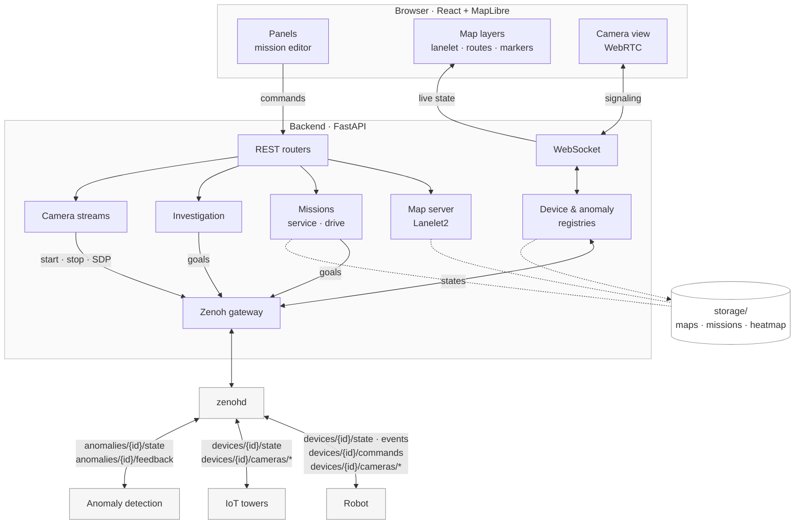
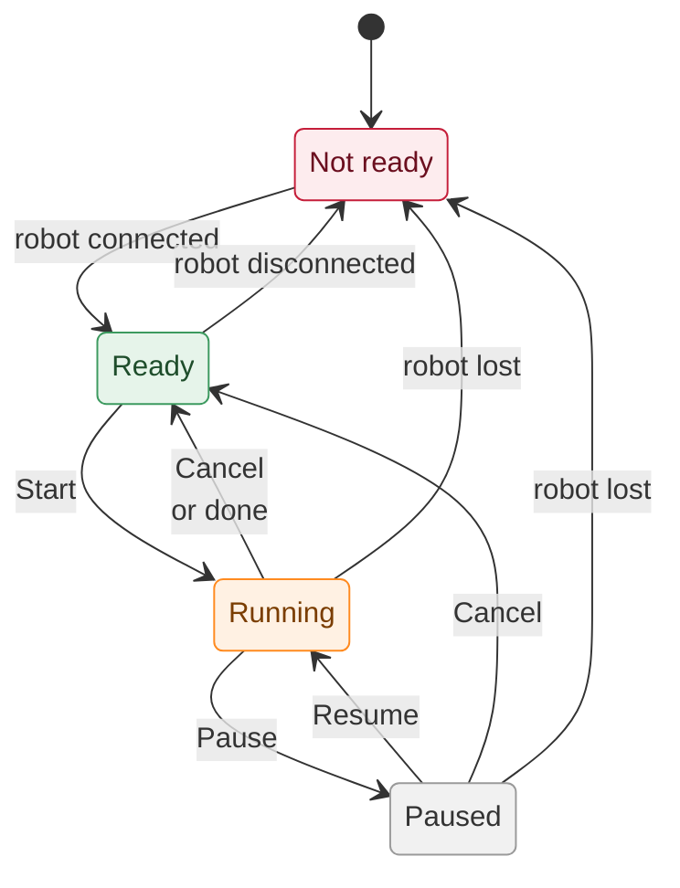
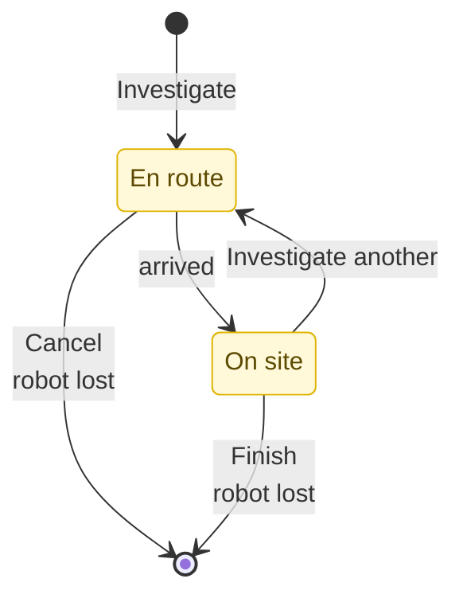

# Mission Manager

Mission Manager is the operator console for the `husky` patrol robot. It shows a live map built from the site's Lanelet2 road network. The map shows where the robot and the IoT towers are, what each tower camera can see, and the anomalies those towers detect. Operators draw patrol missions on the map. Each waypoint snaps onto a lane, and the route between waypoints follows the lanelet graph. A mission can repeat a fixed number of times or loop forever. Operators can start, pause, resume and cancel it from the UI, while the backend sends the robot one goal at a time. When a tower reports an anomaly, the operator can pull the robot off its route to investigate it. The operator watches the camera feeds, records a verdict and sends it back to the anomaly detector, and the robot then returns to its mission. The backend is FastAPI and the frontend is React with MapLibre. Robots, towers and the anomaly detector communicate over Zenoh. Everything runs under Docker Compose.

## Quick start

```bash
docker compose up --build
```

Then open <http://localhost:5050>. Use `--build` again whenever the source code changes. Compose starts three services. The **frontend** is nginx serving the built UI on port 5050. The **backend** serves the REST and WebSocket API on port 8000. **zenohd** is the Zenoh router that robots, towers and the anomaly detector connect to, on port 7447.

## Configuration

Copy `.env.example` to `.env` and edit it for each deployment. Every setting is optional.

| Variable | Default | Purpose |
|---|---|---|
| `PUBLIC_HOST` | `localhost` | IP or hostname other machines use to reach this one. Set it when the UI is opened from another laptop: `http://<PUBLIC_HOST>:5050` |
| `ZENOH_ENABLED` | `false` | Receive robots, towers and anomalies through the stack's zenohd. With it off, you can still author missions |
| `MAP` | `nsh` | Site map, a folder under `backend/storage/maps/` |
| `HOST_UID` / `HOST_GID` | `1000` | Owner of devtools recordings in `data/` |

Data lives in `backend/storage/` on the host, so it survives container rebuilds:

- `maps/<site>/`: one folder per site (currently `ks` and `nsh`), each holding `lanelet2_map.osm` and `map_projector_info.yaml`. The folder name is the map's name.
- `missions/`: saved missions (YAML). Each one records the map it was made on, and only missions for the loaded map are shown. Missions for other maps stay on disk and come back when you switch to their map.
- `app_state.yaml`: the active mission and its progress
- `heatmap/<site>/`: the mission editor's anomaly heatmap. `config.yaml`, `baseline.yaml` and `baseline.jsonl` (dummy history) are tracked; `real.jsonl` (anomalies closed on this machine) is not. See [backend/core/heatmap/README.md](backend/core/heatmap/README.md)

To change the map, set `MAP` in `.env` and recreate the backend. The map is only read at startup.

```bash
docker compose up -d --force-recreate backend
```

If the current mission belongs to a different map, it is cleared on the switch. If the map fails to load, the backend still starts, but with no map and with every mission shown, so check the startup log.

## Devtools

`http://<host>:5050/dev` measures the device links live: per device, ping RTT and loss and the Zenoh session; per stream, rate, inter-arrival jitter, gaps and bandwidth; and WebRTC stats for one camera. **Record** saves everything to `data/runs/<YYYYMMDD_HHMMSS>/` until stopped. Turn a run into plots and `summary.md`:

```bash
pip install --group backend/pyproject.toml:analyzer
python -m tools.analyzer data/runs/<run>
```

**Localize** sets the robot's pose by hand, for when GNSS can't: press **Initialize**, press where the robot is, and drag toward where it faces. The robot's marker shows the result; an error under the cards means zenoh_bridge refused it or didn't reply. Use it with the robot stopped. **Pick pose** works the same way and shows the map-frame x, y and yaw (radians), e.g. for an IoT tower's zenoh_bridge config; **Copy** gives the `x`/`y`/`yaw` lines. A click without a drag gives just x, y. Indoors, start Autoware with `localization_gnss_enabled:=false`.

Design and metrics: [backend/core/devtools/README.md](backend/core/devtools/README.md).

## Architecture

The browser sends commands over REST and receives all live state over a single WebSocket. Only the backend talks to Zenoh: the gateway turns device and anomaly messages into registry updates, and mission drive and investigation send robot goals back out through it. The map server computes every route and waypoint snap from the Lanelet2 map. Missions, maps and the heatmap are files in `backend/storage/`; every closed anomaly is appended to the heatmap's `real.jsonl`.



The browser sends commands over REST and gets live state and camera signaling over one WebSocket. Camera video itself travels over WebRTC between the device and the browser and does not pass through the backend. A background monitor marks devices offline, stops autonomy when the robot is lost, and expires stale anomalies.

## State machines

The mission and the investigation are two separate state machines. While an investigation is active, the investigation controls the robot: mission drive sends no goals, and mission commands return 409.

### Mission



### Investigation



### Rules worth knowing

- **No home position.** Cancel stops the robot where it is.
- **Start and rejoin use the closest waypoint**, measured by lanelet route distance. Waypoint 1 is still where each loop starts and ends.
- **The verdict is committed when the robot leaves the anomaly.** TRUE/FALSE closes the anomaly and sends feedback. UNCLEAR keeps it on the map. Cancel or a lost robot records nothing.
- **A lost robot stops everything.** After 10 s offline, the investigation and the mission both drop to idle. When the robot comes back, nothing resumes on its own.
- **Infinite missions** loop until the operator cancels them.
