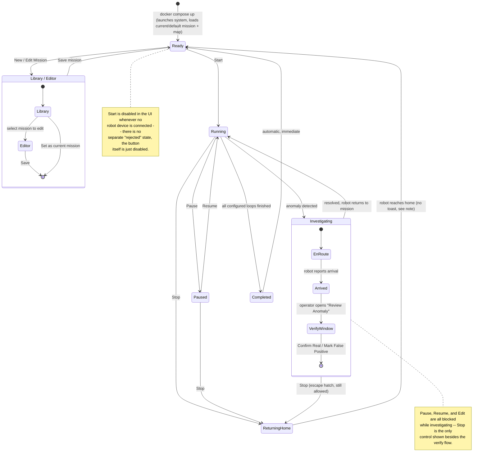

# Mission Manager

A web-based user interface for monitoring and controlling autonomous robots. It consists of a FastAPI backend and a React-TypeScript frontend, containerized and orchestrated using Docker Compose. This project is developed for the `k7-autoware` robot simulation system, providing a centralized interface for mission management, robot monitoring, and system interaction.


## Running with Docker Compose

```bash
docker compose up --build
```
The `--build` flag is only necessary for the initial setup or after changing backend/frontend source. For subsequent runs, a plain `docker compose up` is sufficient. Then open [`http://localhost:5050`](http://localhost:5050).

The backend is reachable directly at `http://localhost:8000` as well (`ports: 8000:8000`). A `zenohd` service also runs in this compose file — the backend connects to it explicitly (`ZENOH_ROUTER=tcp/zenohd:7447`), so this is plain bridge networking, portable to Docker Desktop on Mac/Windows too.

## Configuration

There are two separate places configuration lives, depending on how you're running things:

- **`docker compose` overrides** — copy `.env.example` (repo root) to `.env` and edit it. Compose reads this file automatically for `${VAR:-default}` substitution in `docker-compose.yml`. This is where you toggle Zenoh or point the frontend at a different backend host (see below).
- **Direct backend dev (`uvicorn` without Docker)** — `backend/.env` (loaded by pydantic-settings). `backend/.env.example` documents every available setting with its default.

When running under Docker Compose, every backend setting is passed explicitly via `docker-compose.yml`'s `environment:` block, so `backend/.env`'s contents don't matter there — the compose-level `.env` (previous bullet) is what actually controls behavior.

### Devices come from Zenoh only

There is no in-process device simulator — the backend's only device/anomaly data source is Zenoh (`backend/transport/zenoh_gateway.py`). By default `ZENOH_ENABLED=false` and the app shows empty device/anomaly states; mission authoring (creating/editing missions, route validation) works fine with nothing connected, since that's handled entirely by `mission_server`/`map_server` and never touches devices.

**For a local demo with fake devices:** run the `device_gateway` repo's demo launch (`dummy_robot` + `robot_state_aggregator` + `iot_device` + `iot_state_aggregator`, each behind a `device_gateway_node`) against a `zenohd`, then set `ZENOH_ENABLED=true` here and point `ZENOH_ROUTER` at that same `zenohd` (`docker-compose.yml` already runs one as the `zenohd` service and wires the backend to it).

**For a real robot:** same toggle — `ZENOH_ENABLED=true`, `ZENOH_ROUTER` pointing at your Zenoh router. Your robot/IoT gateway needs to publish JSON matching `backend/models/device.py`'s `DeviceState` shape on the `ZENOH_DEVICE_STATE_KEYEXPR` key expression (default `devices/*/state`), and `backend/models/anomaly.py`'s `Anomaly` shape on `ZENOH_ANOMALY_KEYEXPR` (default `anomalies/*/state`) for anomaly detections — which is exactly what `device_gateway`'s `mission_manager_contract` package produces.

**Frontend backend URL:** if you're viewing the app from a different machine than the one Docker/the backend runs on (e.g. a robot on the local network), set `API_BASE_URL`/`WS_URL` in the root `.env` to that machine's address instead of `localhost` (see `.env.example` for the exact format).

## Local development (without Docker)

```bash
# terminal 1
cd backend && .venv/bin/uvicorn app:app --host 0.0.0.0 --port 8000
# terminal 2
cd frontend && npm run dev   # http://localhost:5173
```

## Mission & Anomaly State Machine

The diagram below reflects the actual backend state machine (`backend/core/mission_execution.py`'s
`MissionExecutionManager`, `MissionStatus` in `backend/models/mission_execution.py`) and the
matching frontend gating (`MissionControls.tsx`/`MissionStatusPanel.tsx`), not just the UI flow —
useful context before adding new functionality that touches mission or anomaly state.



Notes on states that aren't obvious from the diagram alone:
- **Library/Editor is a frontend view state** (`AppShell.tsx`'s `view`), not a backend `MissionStatus`
  value -- entering/exiting it never changes the backend's status away from `READY`.
- **`COMPLETED` is a one-shot broadcast, not a persisted state** (`MissionExecutionManager._finish_mission`)
  -- by the time any client could act on it, the real state is already `READY` again. The frontend's
  `MissionControls.tsx`/`assert_editable`'s guard still nominally accept `COMPLETED` as if it were
  actionable (same as `READY`), but that's defensive/vestigial code for a race window that in
  practice never has time to open, not a real reachable interaction.
- If the robot disconnects mid-investigation, the diversion aborts back toward `Running`/`Ready`
  the same way Stop does (`AnomalyResponseCoordinator.abort_if_robot_disconnected`) -- not shown
  above to keep the happy-path readable.
