# Mission Manager

A web-based user interface for monitoring and controlling autonomous robots. It consists of a FastAPI backend and a React-TypeScript frontend, containerized and orchestrated using Docker Compose. This project is developed for the `k7-autoware` robot simulation system, providing a centralized interface for mission management, robot monitoring, and system interaction.


## Running with Docker Compose

```bash
docker compose up --build
```
The `--build` flag is only necessary for the initial setup or after changing backend/frontend source. For subsequent runs, a plain `docker compose up` is sufficient. Then open [`http://localhost:5050`](http://localhost:5050).

The backend is reachable directly at `http://localhost:8000` as well (`ports: 8000:8000`). A `zenohd` service also runs in this compose file — the backend connects to it explicitly (`ZENOH_ROUTER=tcp/zenohd:7447`), so this is plain bridge networking, portable to Docker Desktop on Mac/Windows too.

## Configuration

There are two separate places configuration lives, depending on how you're running things:

- **`docker compose` overrides** — copy `.env.example` (repo root) to `.env` and edit it. Compose reads this file automatically for `${VAR:-default}` substitution in `docker-compose.yml`. This is where you toggle Zenoh or point the frontend at a different backend host (see below).
- **Direct backend dev (`uvicorn` without Docker)** — `backend/.env` (loaded by pydantic-settings). `backend/.env.example` documents every available setting with its default.

When running under Docker Compose, every backend setting is passed explicitly via `docker-compose.yml`'s `environment:` block, so `backend/.env`'s contents don't matter there — the compose-level `.env` (previous bullet) is what actually controls behavior.

### Devices come from Zenoh only

There is no in-process device simulator — the backend's only device/anomaly data source is Zenoh (`backend/transport/zenoh_gateway.py`). By default `ZENOH_ENABLED=false` and the app shows empty device/anomaly states; mission authoring (creating/editing missions, route validation) works fine with nothing connected, since that's handled entirely by `mission_server`/`map_server` and never touches devices.

**For a local demo** (sibling checkouts next to this repo), start the router with this compose file
(`ZENOH_ENABLED=true` in the root `.env`), then:

| What | Where | Command |
|---|---|---|
| Dummy robot (lanelet-following stand-in for Autoware) | `../husky/experiments/dummy_robot` | `./launch.sh up realsense:=false` |
| IoT tower | `../iot` | `./launch.sh up realsense:=false skeleton:=false` |
| Fake anomalies near the towers | `../anomaly_detection` | `.venv/bin/python -m experiment.experiment` (`--once` for a single one) |

Restart the dummy robot stack as a whole (`./launch.sh down` then `up`): restarting only its
`zenoh_bridge` container resets the goal sequence counter, and the robot then ignores new goals.

**For a real robot:** same toggle — `ZENOH_ENABLED=true`, `ZENOH_ROUTER` pointing at your Zenoh router.

- **Devices** publish JSON matching `backend/models/device.py`'s `DeviceState` on
  `ZENOH_DEVICE_STATE_KEYEXPR` (default `devices/*/state`) — what `zenoh_bridge`'s aggregator produces —
  and receive `navigate_to_goal` / `cancel_navigation` commands on `devices/{device_id}/commands`.
- **Anomalies** come from `../anomaly_detection` and follow its contract
  (`../anomaly_detection/docs/topics_format.md`, section 2): state messages on `ZENOH_ANOMALY_KEYEXPR`
  (default `anomalies/*/state`, parsed as `AnomalyStateMessage` in `backend/models/anomaly.py`), and the
  operator's verdict sent back on `anomalies/{anomaly_id}/feedback`. An anomaly disappears once its
  `degrade_sec` grace period passes without a refresh, unless the robot is investigating it.
- **Anomaly history** is written once per anomaly, when it is resolved or expires, to the
  `anomaly_history` table. It is off by default; enable it with `COMPOSE_PROFILES=db` plus `DATABASE_URL`
  in the root `.env` (see `.env.example`). If Postgres is unreachable, history is dropped and everything
  else keeps working.

**Frontend backend URL:** if you're viewing the app from a different machine than the one Docker/the backend runs on (e.g. a robot on the local network), set `API_BASE_URL`/`WS_URL` in the root `.env` to that machine's address instead of `localhost` (see `.env.example` for the exact format).

## Local development (without Docker)

```bash
# terminal 1
cd backend && .venv/bin/uvicorn app:app --host 0.0.0.0 --port 8000
# terminal 2
cd frontend && npm run dev   # http://localhost:5173
```

## Tests and checks

`scripts/check.sh` runs the same checks as CI; see [`scripts/README.md`](scripts/README.md).

## Backend layout

```
backend/
├── app.py            # FastAPI app: routers, error handlers, startup/shutdown
├── bootstrap.py      # builds every service once (Services) and wires them together
├── config.py         # Settings, read from env / .env
├── api/              # HTTP + WebSocket routers only: parse the request, call one service method
│   ├── deps.py       #   get_services(): how routers reach the services
│   └── errors.py     #   the single mapping from core/errors.py exceptions to HTTP status codes
├── core/             # services and domain logic (no FastAPI imports)
│   ├── mission_service.py    # mission use cases the API calls: CRUD, start/pause/resume/cancel
│   ├── mission_server.py     # mission definitions + YAML persistence
│   ├── mission_execution.py  # runtime mission status state machine
│   ├── mission_drive.py      # drives the robot through the mission's waypoints
│   ├── anomaly_registry.py   # live anomalies: ingest, lifetime/expiry, verdict
│   ├── anomaly_repository.py # write-once anomaly history in Postgres
│   ├── investigation.py      # operator-driven investigate mode (robot to an anomaly and back)
│   ├── goal_arrival.py       # when a robot "arrived" sample counts as reaching a goal
│   ├── camera_stream.py      # start/stop a device camera stream
│   ├── device_registry.py, camera_registry.py, map_server.py, websocket_manager.py
│   ├── monitor.py            # periodic housekeeping (offline devices, robot lost, anomaly expiry)
│   └── errors.py             # domain exceptions
├── models/           # pydantic models: wire payloads, API responses, persisted shapes
├── transport/        # Zenoh gateway (ingest + outbound commands/feedback)
├── tools/            # standalone scripts (anomaly history export)
└── tests/            # pytest suite (see scripts/README.md)
```

## Mission & Investigation State Machines

The robot is driven by two independent state machines. The **mission**
(`MissionStatus`, `backend/core/mission_execution.py`) patrols the route. The
**investigation** (`InvestigationState`, `backend/core/investigation.py`) is
started by the operator on an anomaly and takes priority: while it is active,
mission drive sends no goals and every mission transition is refused (409).
The robot's status pill shows both (`features/devices/robotStatus.ts`).

```mermaid
stateDiagram-v2
    state "Mission" as M {
        [*] --> NotReady
        NotReady --> Ready : robot connected
        Ready --> NotReady : robot disconnected
        Ready --> Running : Start (from the closest waypoint)
        Running --> Paused : Pause
        Paused --> Running : Resume
        Running --> Ready : Cancel (robot holds in place)
        Paused --> Ready : Cancel
        Running --> Ready : all loops finished (COMPLETED broadcast; never for an infinite mission)
        Paused --> Running : investigation ended (rejoin route)
        Running --> NotReady : robot lost
        Paused --> NotReady : robot lost
    }
    state "Investigation" as I {
        [*] --> None
        None --> EnRoute : Investigate (anomaly card)
        EnRoute --> EnRoute : Investigate another (current one abandoned)
        EnRoute --> OnSite : robot reports arrival at the anomaly
        OnSite --> OnSite : verdict TRUE / FALSE / UNCLEAR (draft)
        OnSite --> EnRoute : Investigate another [verdict chosen]
        OnSite --> None : Finish [verdict chosen]
        EnRoute --> None : Cancel
        EnRoute --> None : robot lost
        OnSite --> None : robot lost
    }
```



When an investigation ends, the mission takes the robot back
(`InvestigationCoordinator._hand_back`):

| Mission when it ends | Then |
|---|---|
| Running or Paused | Running, rejoining the route at the waypoint closest by lanelet route distance |
| idle, or no mission | the robot holds in place |

Notes:
- **There is no home.** Cancel stops the robot where it is; nothing drives it back to WP 1.
- **Start and rejoin join the route at the closest waypoint** (by lanelet route distance), shown as
  `target_waypoint_index` with `joining: true`. The waypoints before it count as done for the first
  loop, and reaching it never finishes a loop, even if it is WP 1. WP 1 is still the loop boundary,
  so a mission started near the end of the route has a short first loop.
- **Not ready** means the robot can't run a mission: for now only when it is disconnected; its own
  failure states will join once the robot reports them.
- **The verdict is committed when the robot leaves the anomaly** (Finish, or investigating another
  one). TRUE/FALSE close the anomaly: it is written to `anomaly_history`, sent to Anomaly Detection as
  feedback, and leaves the map. UNCLEAR is recorded but keeps the anomaly on the map for another look.
  Cancelling before arrival, or a robot disconnect, records nothing.
- **Infinite missions** (the editor's "Infinite" box next to the loop count) loop until the operator
  cancels them. Loops are still counted, and the loop count is kept for when the box is unticked.
- **Library/Editor is a frontend view state** (`AppShell.tsx`'s `view`), not a backend status.
- **`COMPLETED` is a one-shot broadcast** (`MissionExecutionManager._finish_mission`); the state is
  idle again immediately.
- **Losing the robot stops everything.** Once the robot has been offline for `ROBOT_LOST_GRACE_SEC`
  (default 10 s; the UI shows it offline after 3 s), `MissionService.abort_autonomy` cancels the
  investigation without a verdict and drops the mission to idle. Nothing resumes on its own: when the
  robot reports in again it is sent `cancel_navigation`, and the operator has to Start or Investigate
  again. The same entry point is meant for a future joystick takeover.
- **There is no timeout on an investigation.** The Investigate card shows the distance to the
  anomaly and the elapsed time; the operator decides whether to Cancel.
