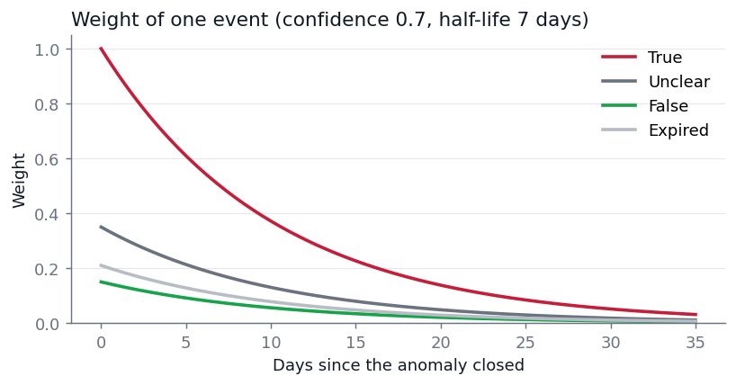
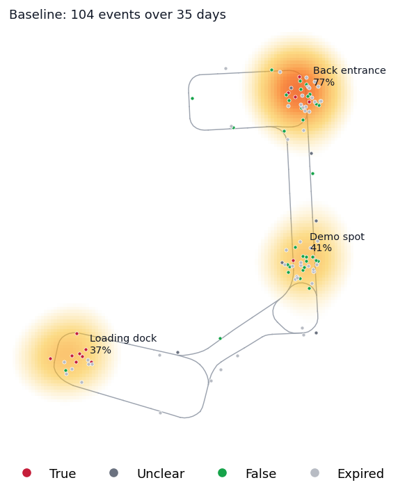
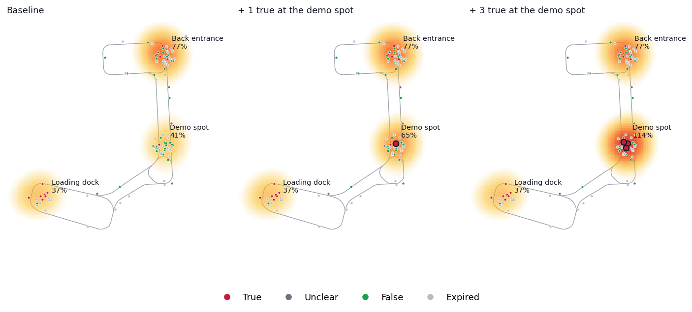
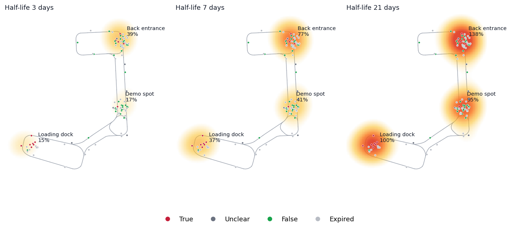

# Anomaly heatmap

The mission editor draws a heatmap of past anomalies under the lanes, so the operator can place patrol waypoints where incidents happen. It combines two sources:

- **Baseline**: a simulated history of about a month, generated from a short spec of hotspots. It gives the map a believable starting point on every launch.
- **Real**: every anomaly that closes while Mission Manager runs, by an operator verdict or by expiring.

Each event counts by its verdict, anomaly type, detector confidence and age. A recent true positive therefore stands out clearly against the older, mostly unverified baseline. That is the demo: verify an anomaly as true, reopen the editor, and the spot is redder.

## Data flow

```
anomaly closes ─ AnomalyRegistry ─► HeatmapService.record_final ─► real.jsonl
   (verdict or expiry)

GET /api/map/heatmap ─► baseline.jsonl + real.jsonl ─► weights ─► Gaussian kernel sum ─► / full_at ─► image
                         (cached until a file changes, at most 5 min for the time decay)
```

## Model

### Event weight

Every event $i$ gets a weight

$$
w_i = v(r_i)\; \tau(T_i)\; c_i^{\,[r_i \in C]}\; 2^{-a_i / h}
$$

| Term | Meaning | Default |
|---|---|---|
| $v(r_i)$ | Verdict weight: true, unclear, false, expired | 1.0, 0.5, 0.15, 0.3 |
| $\tau(T_i)$ | Type weight, the largest over the event's types | 1.0 for all three types |
| $c_i^{[r_i \in C]}$ | Detector confidence, applied only to the verdicts in $C$ | $C$ = {unclear, expired} |
| $2^{-a_i/h}$ | Time decay: age $a_i$ in days, half-life $h$ | $h$ = 7 days |

Confidence only scales unverified events. Once an operator has looked, their verdict is better evidence than the detector's score. Expired still weighs something: nobody checked, but something was seen.



### Heat

Heat at a point $s$ is the weighted sum of peak-1 Gaussians, one per event:

$$
H(s) = \sum_i w_i \exp\!\left(-\frac{\lVert s - s_i \rVert^2}{2\sigma^2}\right), \qquad \sigma = 4\ \text{m}
$$

A fresh true positive adds exactly 1 at its own location. $H$ is therefore a count of "weighted events nearby". It is computed on a grid of 0.5 m cells (at most 400 per side) with a separable blur, in a few milliseconds.

### Color scale

The scale is fixed and linear:

$$
I(s) = \min\!\left(1,\; \frac{H(s)}{H_\text{full}}\right), \qquad H_\text{full} = 4
$$

The frontend draws $I$ transparent below 0.08, then amber → orange → orange-red. The same color means the same heat on every day and every map, and one more true positive always adds $1 / H_\text{full}$ (25%) where it happens, until the spot is full.

### Steady state

A hotspot with $r$ events per day of mean weight $\bar w$, observed for $D$ days, settles at about

$$
H \approx r \cdot \frac{h}{\ln 2} \left(1 - 2^{-D/h}\right) \cdot \bar w \cdot k
$$

where $k \le 1$ is the kernel's average over the hotspot's disc (0.87 for a 3 m radius and $\sigma$ = 4 m). For example, the nsh demo spot has 1.2 events per day, mostly expired and false ($\bar w \approx 0.29$), over 35 days. That gives $H \approx 3.0$ on average, which matches 200 simulated seeds (mean 2.99).

A hotspot meant to show change should sit at **40–60%** of $H_\text{full}$; one already near 100% cannot get redder. Recent events dominate at $h$ = 7 days, so the seed matters: across seeds the same demo spot lands between 2.0 and 4.1 (10th–90th percentile). The nsh baseline uses seed 12, which puts it at 41%. Pick the seed in /dev, where each hotspot shows its level now and after one more true positive.

## Baseline

`baseline.yaml` describes the simulation. `baseline.jsonl` holds its result, like a lockfile, so the baseline doesn't change with a numpy upgrade and its diffs stay reviewable.

```yaml
days: 35        # history length
seed: 12
hotspots:
- name: Demo spot
  x: 26.5       # map frame, meters
  y: 18.0
  radius_m: 3
  per_day: 1.2  # events per day
  verdicts: {true_positive: 0.1, unclear: 0.1, false_positive: 0.3, expired: 0.5}  # relative shares
  types: [trespassing]
  confidence: {low: 0.5, high: 0.95}
background:     # scattered along the lanes
  per_day: 1.0
```

Each hotspot draws $N \sim \text{Poisson}(r D)$ events, uniform in time over the last $D$ days and uniform in its disc. Verdict, type and confidence are drawn from the spec. The background is placed along the lane centerlines with 0.6 m of lateral noise.

Events are stored with their **age** (`age_days`), not a date. A baseline generated weeks before a demo still looks the same on the day.



## Real events

`real.jsonl` gets one line per closed anomaly, with its close time. It is not tracked in git: it differs per machine and per test run. Ages are computed from the close time on every render, so real events fade like the baseline. A true positive verified during the demo has full weight:



## Files

`backend/storage/heatmap/<map>/`, where `<map>` is the map's name (`MAP_NAME`, or the map folder's name):

| File | Content | Git |
|---|---|---|
| `config.yaml` | Weights, half-life, $\sigma$, $H_\text{full}$. Built-in defaults when missing | tracked |
| `baseline.yaml` | Simulation spec | tracked |
| `baseline.jsonl` | First line `{"meta": …}` (generated_at, simulator version, spec hash, merged real count), then one event per line | tracked |
| `real.jsonl` | One closed anomaly per line | ignored |

If `baseline.yaml` was edited by hand without generating again, the spec hash no longer matches and /dev says so.

## /dev › Heatmap

- **Two maps side by side**, each showing *Baseline* or *Baseline + real*, moving together. **Save image** downloads both with the current parameters printed below, for reports.
- **Weights**: every term of $w_i$, the half-life, $\sigma$ and $H_\text{full}$, previewed live. **Save** writes `config.yaml`.
- **Baseline**: edit hotspots (add by clicking the map, drag to move), history length, background and seed. Each hotspot shows its level now → after one more true. **Save & generate** writes `baseline.yaml` and `baseline.jsonl`.
- **Real**: **Clear** deletes `real.jsonl`, for example before a demo. **Merge into baseline** moves real events into `baseline.jsonl` with their current ages, to keep a rehearsal as part of the history. **Place trues** adds unsaved what-if true positives to the *Baseline + real* view.

Effect of the half-life on the same baseline:



## Demo checklist

1. In /dev › Heatmap › Baseline, put the demo spot where the audience will trigger anomalies and check it sits at 40–60%. Use **Place trues** to see one or two verifications there.
2. **Clear** real events left over from rehearsals.
3. During the demo, verify the anomaly as true, then reopen the mission editor.
4. Say up front that the baseline is simulated history.

## Figures

The images here come from `storage/heatmap/nsh`:

```bash
cd backend && .venv/bin/python -m core.heatmap.figures
```
