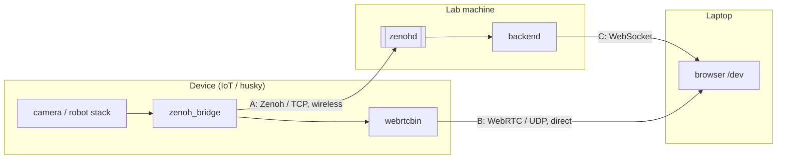

# Devtools: network and data-path measurement

Status: phase 1 implemented.

A developer page at `http://<lab-machine-ip>:5050/dev` for measuring how data gets from the devices (IoT towers, husky) to the operator's browser. It serves two uses:

- **Live**: while testing or deploying, see right away which link or stream is misbehaving.
- **Record**: press Record, run a scenario, stop. The run is saved to a folder and an offline analyzer turns it into plots and tables for reports.

## Paths



| Path | What we want to know |
|---|---|
| A. Device → zenohd → backend | How telemetry crosses the wireless link: rate, jitter, gaps, delivery, latency |
| B. Device → browser (video) | Media quality: packet loss, jitter, fps, freezes, bitrate, RTT |
| C. Backend → browser | Last hop to the operator, needed for end-to-end latency |

Zenoh runs over TCP, so the transport never loses packets on path A. A bad link shows up as latency spikes, bursts, gaps, reconnects and congestion drops at the sender. Path A is therefore measured by delivery ratio and gaps. Packet loss is measured on path B (UDP) and with ping/iperf3.

Video on path B does not pass through the lab machine. Its numbers include the laptop's own link, so laptop link conditions are recorded with each run (wired if possible).

## End-to-end latency

Each hop gets a timestamp, so the total splits into parts:

```text
t0 capture/generate  (payload timestamp; skeleton keeps camera header.stamp)
t1 device publish    (zenoh_bridge put)               t1 - t0  device processing
t2 backend receive                                     t2 - t1  path A
t3 backend send (WebSocket)                            t3 - t2  backend processing
t4 browser receive                                     t4 - t3  path C
```

- Clocks: devices and the lab machine run chrony with the lab machine as NTP server, which also works on a LAN without internet. The browser's offset to the backend is estimated from WebSocket ping (NTP-style, four timestamps), so the laptop needs no setup.
- Until the bridge adds `t1` (phase 2), `t2 - t0` reports device processing plus path A together.
- The operator-facing alert path is longer: skeleton → anomaly_detection → `anomalies/*` → backend → browser. It can be measured the same way once anomaly payloads carry the source frame timestamp.

## Metrics

**Path A**, per device and stream (`state`, `health`, `skeleton`, `camera_state`, `events`), in 1 s windows:

- rate vs expected rate
- inter-arrival jitter (stdev of arrival intervals, IPDV per RFC 3393)
- gaps: no sample for 3× the expected period; count, longest, when
- bandwidth and payload size
- one-way latency (`t2 - t0`), needs synced clocks
- RTT via an echo queryable on the device; no clock sync needed (phase 2)
- delivery ratio: device sent vs backend received (phase 2: `BridgeStats` on Zenoh)
- loss, reorder, duplicates: from a `seq` field (phase 2). Skeleton already carries `frame_index`, but gaps there also include frames skeleton skipped.
- Zenoh session reconnects and downtime

**Path B**, from `RTCPeerConnection.getStats()` in the browser:

- `inbound-rtp`: `packetsLost` / loss %, `jitter`, `framesPerSecond`, `framesDropped`, `freezeCount`, `totalFreezesDuration`, bitrate, `nackCount`, `pliCount`, `jitterBufferDelay`
- `candidate-pair`: `currentRoundTripTime`, `availableIncomingBitrate`, selected candidate types
- session setup: negotiation time, time to first frame
- optional glass-to-glass latency: timestamp overlay on the device stream, compared in the browser

**Path C**: WebSocket RTT, `t4 - t3`, message rate and size.

**Link baseline**: ICMP ping RTT and loss per device, from the backend; iperf3 TCP throughput and UDP loss/jitter at a target bitrate. Link capacity minus measured usage gives headroom.

## Method

- Report distributions: p50 / p95 / p99 / max, time series and CDF. Not only the mean.
- Pass/fail thresholds per stream, e.g. state latency p95 < 200 ms, delivery ≥ 99.9 %, video loss < 1 %, fps ≥ 25, no freezes. Values to be agreed.
- Scenarios: idle baseline; nominal (all devices up); stress (all cameras open); robot driving its route, with metrics placed on the map as a coverage map; fault injection with `tc netem` (delay, loss) to check offline timeouts, reconnects and mission abort.
- Each run records its conditions (devices, AP, distance, commits, config). Repeat a scenario at least 3 times.

## Design

- **Access**: always on, no flag. The page is a separate route of the main frontend, because WebRTC stats are only visible in the browser that receives the stream and the page should use the same `webrtcClient`. nginx needs an SPA fallback for `/dev`.
- **Cost when idle**: the backend keeps per-stream counters for the samples it already receives, which is negligible. Extra subscriptions, active probes, iperf3 and recording run only while the page asks for them.
- **Backend**: `/api/dev/*` plus a WebSocket channel (`/api/dev/ws`) that pushes 1 s windows. Windows run on the monotonic clock, so wall-clock corrections (NTP, WSL) don't distort intervals; wall time is only used for timestamps and latency.
- **Device IPs**: from the zenohd admin space. The bridge subscribes to `devices/{id}/commands`, so `@/*/router/subscriber/devices/*/commands` gives the device's Zenoh session and `@/*/router` gives that session's remote address. Behind NAT or a port proxy that address is wrong; set it by hand on the page.
- **Recording**: one folder per run, tool-agnostic so a shared analyzer can read it later. Analyzer output goes into the same folder.

  ```text
  data/runs/20261031_093000/
  ├── metadata.yaml   # start/end, label, device IPs
  ├── windows.csv     # 1 s aggregates per device and stream: rate, jitter, gaps, bandwidth
  ├── samples.csv     # every received sample
  ├── ping.csv        # one ping per device per second
  ├── links.csv       # Zenoh session per device per tick
  ├── webrtc.csv      # getStats, one row per second
  ├── ws.csv          # backend -> browser WebSocket RTT
  ├── robot.csv       # robot pose, to place metrics on the map
  ├── summary.md      # analyzer
  └── *.png           # analyzer
  ```

- **File ownership**: the backend container runs as root, because ICMP ping needs raw sockets. Files it writes into the bind mount would be root-owned, and Docker creates a missing `data/` as root too, so the analyzer (or a shared analyzer submodule) run as the user could not write next to them. The backend `chown`s `data/`, `data/runs/` and everything it records to `RUNS_OWNER`, which compose sets from `HOST_UID:HOST_GID` (default `1000:1000`).
- **Git**: `/data/` is ignored as a whole. `./data` is mounted into the backend container.
- **Analyzer**: `python -m scripts.analyzer data/runs/<run>` writes `summary.md` (percentiles, delivery, gaps, WebRTC) and plots: one figure per device (ping, rate, jitter, bandwidth), ping CDF, WebRTC, and a coverage map of the robot's ping RTT along its route.

## Phases

1. **Mission Manager only**, enough for field testing without touching the devices: passive Zenoh tap (rate, jitter, gaps, bandwidth, payload size, reconnects), ICMP ping per device (RTT, loss; device IPs from the zenohd admin space if available, otherwise entered by hand), WebRTC `getStats()`, robot pose in recordings, record to a run folder, analyzer. Latency `t2 - t0` is shown but marked unsynced until clocks are synced.
2. **zenoh_bridge**: `seq` and `t1` in payloads, an echo queryable for RTT and clock offset, `BridgeStats` published on `devices/{id}/stats`.
3. **Extras**: iperf3 server container, netem scenarios, route coverage map, automated pass/fail report.

## Open questions

- Phase 2 changes `zenoh_bridge`, a submodule of `iot` and `husky`.
- Pass/fail thresholds.
- Whether the analyzer becomes a shared repo (see below).

### Shared analyzer

A generic analyzer repo used as a submodule by mission_manager, iot and husky is a good direction, but not yet: `iot/tools/analyzer` reads MCAP from ROS and this one reads its own run folder. First, agree on a common run format (`metadata.yaml` + time-series tables with known columns). Once two producers write it, extract the shared plotting and summary code.
