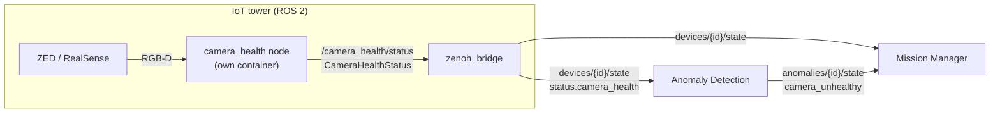

# FVD Encore: dwell, three cameras and camera health

Status (2026-11-20, `feat/encore`; demo 2026-11-23):

| | Feature | State | Issue |
|---|---|---|---|
| R2 | **Dwell**: each mission waypoint can hold the robot for a set time | Done | #__ |
| R3 | **Three cameras** on the robot | Done: one stream, split into three in Mission Manager | #__ |
| R4 | **Camera blind**: a tower whose camera can't see raises the alarm | Message and zenoh_bridge done; Mission Manager done (`camera_unhealthy`); the node and Anomaly Detection in progress (teammate) | #__ |

R0 (where the robot stops) is done: viewpoint stop and blocked arrival. R1 (Explore) is redone on the investigate mode. See [R0 and R1](#r0-and-r1). Lost tracks (trespassing a tower loses) are the teammate's, with the edge-case tests; not covered here.

## Background

Goals go to the robot one at a time as a single pose (`navigate_to_goal`). Autoware plans the path to it on the same Lanelet2 map, so the route Mission Manager draws is a preview of the shortest path, not a path the robot is told to follow. state_machine reports success once the route is `ARRIVED` and the wheels have stopped, and stays `arrived` until the next goal, a cancel or a takeover. While the LiDAR sees an obstacle on the route it reports `blocked`, and its 10 s `not_moving` timer is paused, so a blocked goal never fails on its own.

All three features work within that: they choose which goal to send, and when.

---

## R0 and R1

**R1, Explore: redone on the investigate mode (2026-11-21).** For places no anomaly was raised for, or no tower sees: the operator picks a point, the robot goes to look, and returns to the mission when dismissed. The first version (`febc9a4`: ring, sight line, preview route) was dropped; this one reuses what the investigate mode already has.

| | Explore |
|---|---|
| Entry | **Explore** pill beside Overview, bottom left; while picking it reads "Click a point to explore · Cancel" (grey). A click picks the point, another moves it; Esc cancels |
| Picked | A plain grey "×" with a white halo, no disc; its stop, a white dot ringed grey, since the point may be off the lanes. No route before Investigate, as for an anomaly |
| Card | **Explore**, two rows: Position (x, y), Distance (driving). [Investigate] [Cancel]. Shares the slot with the selected anomaly |
| Sent | The "×" stays grey (it grows while the card is hovered); the stop's ring turns dark yellow, the yellow route appears; En route · 12 m / On site |
| On site | The observe window shared with the camera check (robot's three cameras); the card's [Observe] [Back to route] end it, no verdict |
| Stop | R0's viewpoint rule: the shortest drive to a lane point that sees it within 4 m |
| Priority | Like switching anomalies: an anomaly on site needs its verdict first; anything else is taken over, and an anomaly takes over from Explore |

Backend: `InvestigationKind.EXPLORE` (`anomaly_id` None), `look_at` on every investigation, `POST /api/investigation/explore` and `/explore/preview` ({lat, lon}). Checked on the dummy robot: a point 3 m off the lane → stop 3.9 m from it on the lane, 5.5 m drive, on site, Back to route.

**R0, where the robot stops: done (2026-11-20).** The problems: a person lying on the lane is an obstacle at the goal, so the robot stops short, reports `blocked`, and never arrives to verify; and the nearest lanelet point may be a U-turn away while another lane passes within view.

- **Stop where the robot first sees the anomaly.** On every lanelet within 4 m of it, the first centerline point with the anomaly within 4 m and ahead (the front half along the lane; the three cameras face forward), plus where the robot stands if it already sees it. The goal is the one with the shortest drive, heading along its lane (`MapServer.viewpoints`, `VIEW_RANGE_M = 4.0`). None found: the nearest lanelet point, as before. `visible_stop: false` turns it off
- A person lying on the lane is seen from 4 m before them, so the robot arrives by its goal instead of being stopped by them
- On the nsh map, from the dummy robot's pose: an anomaly 4 m behind it was a 100.9 m drive to its nearest point, 35.1 m to a viewpoint on the opposite lane; 8 m behind, 98.6 → 38.5 m. On the dummy robot, an anomaly 12 m ahead on the lane: stop 3.96 m before it, normal arrival
- **Blocked arrival.** While an investigation is EN_ROUTE, a robot reporting `blocked` within **3 m of driving distance** of its stop for **2 s** counts as arrived: `cancel_navigation`, ON_SITE, and the verify (or camera check) window opens as on a normal arrival
- Driving distance, not a radius: a route is planned from the robot to the stop, so a robot on the opposite lane, a U-turn away, isn't close however near it looks. Routing only happens once the straight line is already within 3 m
- 2 s rather than 0: a `blocked` that only flickers (someone walking past) doesn't count, and the robot has come to rest
- On site, the investigation route is no longer drawn, so no stub is left across the person
- 3 m: the LiDAR stops the robot about 2 m before an obstacle, measured from its front; the pose is the body's centre, half a metre further back, and the stop is the lane's centre line, behind the body's near edge
- Config: `arrive_blocked_within_m` (3.0), `arrive_blocked_after_sec` (2.0)
- Blocked arrival, checked on the dummy robot: blocked 1.1 m short → on site 2.2 s later; blocked 3.4 m short → still en route after 12 s, and arrives normally once the obstacle clears
- **To check on the real robot:** how far the LiDAR stop keeps it from a person (about 2 m, per the teammate). Farther than 3 m, raise `arrive_blocked_within_m`

---

## R2: dwell

### Behaviour

Each mission waypoint has `dwell_sec` (default 0). On arrival the robot holds that long, then heads to the next waypoint. There is no way to end a dwell early: a mission is a fixed, periodic plan. Running missions can't be edited (`assert_editable`), which keeps this consistent.

No robot-side change: state_machine stays `arrived` after a goal, and `not_moving` only times an active goal.

### Model

```python
class Waypoint(WireModel):
    dwell_sec: float = Field(default=0.0, ge=0.0, le=600.0)   # old mission files load with 0

class MissionExecutionState(WireModel):
    dwell_remaining_sec: float | None = None                   # set while holding at current_waypoint_index
    dwell_sec: float | None = None                             # that waypoint's full dwell, for the ring
```

The manager keeps the deadline privately on `time.monotonic()` and fills `dwell_remaining_sec` when it broadcasts. The browser counts down from the value it received; no absolute time crosses the wire (the browser's clock isn't synced with the lab machine).

### Mechanism

`MissionDriveCoordinator.advance()` stays safe to call at any time; it gains one precondition.

1. ARRIVED → `record_waypoint_reached(i)`. If the mission continues and waypoint *i* has `dwell_sec > 0`, the manager sets the deadline.
2. `advance()` returns while dwelling and schedules a token-guarded wake-up at the deadline (like `_timeout_then_retry`).
3. The wake-up clears the deadline and calls `advance()`, which sends waypoint *i + 1*.

| Case | Result |
|---|---|
| Pause while dwelling | Remaining time frozen into `dwell_remaining_sec` |
| Resume after pausing while dwelling | Continue the dwell, **without `rejoin()`** (below) |
| An investigation takes the robot | Dwell dropped; no dwell on return unless the join target has one |
| Cancel, robot lost, mission switched | Dwell dropped |
| Arrival while joining | Dwells if the waypoint has one |
| Arrival at waypoint 1 that completes the mission | No dwell |
| Arrival at waypoint 1 on a non-final loop | Loop counted, then dwell |

**Why Resume must not rejoin while dwelling.** A robot standing on waypoint *i* counts as on the leg into *i* (`leg_at`), so `rejoin()` would pick *i*, send a goal to where the robot already is, and the arrival would start the full dwell again.

### UI

**Editor (mauve).** Rows stay as they are; a waypoint with a dwell shows it right-aligned and muted. The selected row expands with a dwell stepper styled like the Loops stepper (±5 s). The route summary adds the total dwell per loop. Map markers are unchanged.

```
Waypoints                                    4
 ① 12.40, −3.10
 ② 18.02,  4.55                           30 s
┌───────────────────────────────────────────────┐
│ ③ 25.71,  9.88                       Remove  │
│    Dwell   [ − ]  30  [ + ] s                │
└───────────────────────────────────────────────┘
 ④ 31.20, 15.03

 Route OK · 86 m per loop · 1 min 30 s dwell
```

**Monitor: the robot's status pill counts down.** Dwelling is something the robot does, so it shows where the robot's state is: the RobotCard pill (and the inspector's) reads "Dwell 0:18" instead of "Patrolling". Pills use tabular figures, so the pill keeps its width as it counts. Paused, the robot pill reads "Holding" as for any paused mission. Map markers are unchanged.

**Statuses stay simple.**

- The mission pill keeps the mission's own states only: Not ready, Ready, Running, Paused.
- The robot pill has no live dot (whether the robot is up is the connection pill's job).

### Tests

- Mission with dwell waypoints: each next goal is sent only after the dwell
- Every row of the table above, especially pause and resume while dwelling (no extra goal, remaining time kept)
- Old mission YAML without `dwell_sec` loads with 0

---

## R3: three cameras

Three USB webcams on the robot, composed into the one camera stream the robot already has, so nothing between the robot and the browser changes.

| Where | What |
|---|---|
| husky `modules/camera_tower` (`three_camera_combiner`, teammate) | Three V4L2 MJPEG cameras at 320×240, 15 fps, side by side into one 960×240 `bgr8` image on `/device/camera/front/image_raw`. A missing or stale camera is a black tile. Only composes while someone subscribes. `camera_tower:=true` in `main.launch.py` |
| zenoh_bridge `213067f` | Each WebRTC stream takes its size from the camera's first frame, so the 4:1 frame isn't squeezed |
| Mission Manager `784b314` | `cameraTiles.ts`: a frame of three 4:3 images (4:1, ±10 %) counts as three tiles. `CameraStreamView` shows one large (the middle one by default) and all three as thumbnails to pick from. Any other frame is shown whole, so the towers are unchanged |

The order follows `camera_devices` in `config/camera_combiner.yaml` (left, centre, right); thumbnails are labelled Cam 1–3 for now.

To check on the robot: CPU on the Orin next to Autoware (`tegrastats`; the encoder is still CPU `openh264enc`), and whether the robot still drives normally (no `not_moving`).

---

## R4: camera blind

A tower whose camera can no longer see (lens covered, washed out, depth gone) should be noticed, so the robot can cover what the tower can't see.

### Data flow



| Part | Owner | State |
|---|---|---|
| `patrolknight_msgs/msg/CameraHealthStatus.msg` | teammate | Done |
| `camera_health` node and container in `iot` | teammate | Open |
| zenoh_bridge: subscribe and forward (`525abf1`) | KoKo | Done |
| Anomaly Detection: what camera health means | teammate | Open |
| `anomaly_detection` transport wire models | KoKo | Open |
| Mission Manager: show it, react to it | KoKo | Open |

### Contract

```
# CameraHealthStatus.msg
std_msgs/Header header
bool has_sufficient_samples   # ≥ 8 RGB-D samples in the 2 s window; when false the flags keep their last values
bool occluded                 # a nearby obstruction blocks nearly the whole view
bool overexposed              # near-white, low-detail region ≥ 25 % of the image
bool depth_degraded           # invalid depth pixels ≥ 90 %
```

zenoh_bridge copies the four flags unchanged into `status.camera_health` of `devices/{id}/state` (parameter `camera_health.topic`; left out, the subscription is off, in either device mode). It makes no judgement. Device state keeps going out at its own rate, so a health message older than 2 s goes out as `null`:

| `status.camera_health` | Meaning |
|---|---|
| absent | The device isn't monitored |
| `null` | Monitored, but no current data (node stopped or slow) |
| object | The latest result |

Mission Manager already accepts it: `DeviceState.status` is a free dict, so the field reaches the backend and the frontend unparsed; nothing reads it yet.

### Anomaly Detection (teammate): `camera_unhealthy`

Decided 2026-11-19 with the teammate: Anomaly Detection owns the reaction, Mission Manager only shows what it receives.

- Any flag set: one `camera_unhealthy` anomaly per tower, `types: ["camera_unhealthy"]`, at the tower's own position, `confidence: 1.0` (a convention, not a probability). Same `anomaly_id` for the whole unhealthy episode
- While unhealthy, the tower's human anomalies are suspended: not created, refreshed or published, so they decay in Mission Manager. They still expire in AD's registry
- Recovered (fresh data, enough samples, all three flags false): `camera_unhealthy` stops being published and decays; surviving human anomalies resume with their original `detected_at`
- Demo story: a healthy tower reports people; an unhealthy one reports only that it can't be trusted; once it recovers, its anomalies come back
- Still to agree: what AD does while `camera_health` is `null` or `has_sufficient_samples` is false; `camera_unhealthy` with `degrade_sec` 1 s, refreshed with every device state (~2 Hz), so the tower turns back 1–2 s after it recovers (Mission Manager expires anomalies once a second); 0.5 s would leave no room for one late message, and the tower would blink

### Mission Manager

**The tower is the anomaly.** `camera_unhealthy` gets no anomaly marker; its tower's marker turns red with a white "!", keeping the tower's shape (yellow and pulsing while the robot is sent there). Its field of view turns translucent red. Clicking the red tower opens the anomaly card; the towers list's "i" still opens the device window. The marker matches by `source_device_id`, not x/y, so the two never overlap.

**Human anomalies near a red tower** keep clustering among themselves, but never with the tower: any marker the red tower would cover is hidden and counted on the tower's corner badge, the badge already used for anomalies under the investigated one (click zooms in).

**Card.** Type, Reason, Detected: Reason takes Confidence's row, so the card keeps its height. Reasons come from the tower's `status.camera_health`, in a fixed order, on one line ("Occluded, Overexposed +1", the full list on hover); "No data" when it's `null`.

**Investigate: a camera check, no verdict.** Investigation `kind = camera`, linked to the anomaly. The robot goes to the tower's nearest lanelet point as for any anomaly. On site the window shows the robot's three cameras (thumbnails, R3) or, through the switcher, the tower's own; no verdict and no button: Observe and Back to route / Done live on the investigation card, which ends it. Nothing is sent to Anomaly Detection: the anomaly stays until the camera recovers. It can be taken over by another anomaly at any time.

**Not heat.** `camera_unhealthy` is never recorded for the heatmap (`HumanAnomalyType` there).

| File | Change |
|---|---|
| `models/anomaly.py` | `camera_unhealthy` in `AnomalyType`, `HumanAnomalyType`, `Anomaly.is_camera_unhealthy` |
| `models/investigation.py`, `core/investigation.py` | `InvestigationKind.CAMERA`: from `start()` for a camera anomaly; no verdict (409); ends from either phase without `_commit` |
| `models/heatmap.py`, `core/heatmap/service.py` | Human types only; camera anomalies skipped |
| `deviceStore.ts` | `selectCameraAlarms`: each tower's open camera anomaly |
| `DeviceMarkerLayer.tsx` | Red tower with "!", click → anomaly card |
| `TowerFovLayer.tsx`, `mapPalette.ts` | Red FOV |
| `AnomalyLayer.tsx`, `anomalyGroups.ts` | No marker for camera anomalies; `hideUnderAlarmTowers` |
| `AnomalyInfoRows.tsx`, `towers.ts` | Reason row (`cameraHealthReasons`, `formatReasons`) |
| `InvestigateCard.tsx`, `VerifyModal.tsx`, `InvestigationNotifier.tsx` | Observe / Done; `CameraCheckDialog`; arrival toast |

**Anomaly Detection's transport:** `camera_unhealthy` added to `transport/messages.py` and `docs/topics_format.md` on `anomaly_detection` main (2026-11-20).

### Testing without the real node

`anomaly_detection/experiment/camera_tower.py` (`.venv/bin/python3 -m experiment.camera_tower`) is a fake tower at (20.13, 35.36): it publishes `devices/iot-fake-01/state` with `camera_health`, no FOV, and plays AD's planned behaviour: human anomalies while healthy; `camera_unhealthy` and suspended humans while unhealthy (Enter toggles, letters set the reasons). Run it with the dummy robot to go through Investigate → camera check → Back to route.

---

## Investigation on the map (2026-11-20, to try at the test)

Rules: yellow only for what the robot is working on (its route and the frozen target, an anomaly or a camera check's tower); everything else steps back without disappearing; a pulse only when the operator is needed, one at a time.

| Element | While investigating |
|---|---|
| Mission route | The same line in pale orange (normal width, opaque `#ffc999`; see-through orange over the grey lanelet lines turned to mud): the patrol it goes back to. Waypoints stay hidden (their numbered discs made the map busy) |
| Investigation route | Yellow, trimmed to what lies ahead; hidden on site (a dark casing was tried and dropped) |
| Target | Yellow "!" (anomaly) or yellow tower (camera check), as before; still while en route |
| Stop | A small white dot with a dark yellow ring at the route's end, still: where the robot parks, not a second destination |
| Pulse | The target's ring, on site: an anomaly until a verdict is picked, a camera check until Back to route. Transform and opacity only, no repaints |
| Other anomalies | 60 % opacity, still clickable |
| On Investigate | If any of the route is off screen, the view eases out until it all shows (never in) |
| Card hover | Hovering the investigation card grows its target on the map (the anomaly, or a camera check's tower, with a yellow ring) |
| Robot pill | "En route · 12 m": the route left ahead, updated as it drives. Meters to 100, tens of meters to 1 km, then km, like a navigation app; padded to three digits with figure spaces so the pill keeps its width. Meters, not an ETA: the speed varies with turns and obstacles, so a countdown would jump |
| Back to the mission | No line: the target waypoint pulses as before. A dashed join line, then a solid orange line from the robot to its goal, were tried and dropped: clearer, but they didn't look right |

To ask at the test: does the faint mission line help or clutter, is the stop readable as "parks here, looks there", and is 60 % too faint for new anomalies.

---

## Next (2026-11-20)

**R4 camera blind.** Check it on the browser with the fake tower and the dummy robot; agree the `null` / low-sample behaviour and `degrade_sec` with the teammate; then with the real `camera_health` node.

**R3.** Check CPU and driving on the robot; name the thumbnails by position if wanted.

**R0.** On the real robot: whether 4 m is close enough to verify on the three cameras, and how far the LiDAR stop keeps it from a person (blocked within 3 m of driving distance for 2 s counts as arrived; farther, raise `arrive_blocked_within_m`). If the viewpoint stop misbehaves, `visible_stop: false` goes back to the nearest lanelet point.

**Camera windows layout (after the test, before or after the Encore).** All camera windows share one layout (`CameraWindow.module.css`): the feed on the left, a sidebar of sections on the right.

| Window | Sidebar today | Verdict |
|---|---|---|
| Verify | Anomaly facts + the TRUE / FALSE / UNCLEAR choice | Full: keep as it is |
| Device inspector | Status and position sections | Has content, a bit sparse |
| Camera check, Explore | Two to four facts, no buttons (the card ends them) | Mostly empty: change |

The sidebar is the verdict's place; without a verdict it has nothing to hold, and it takes width the three-camera view (a 4:1 frame plus thumbnails) could use. Options for the windows without a verdict:

- **A. No sidebar, facts on the feed (recommended).** The stage takes the whole width; the few facts sit in a slim strip under the title, or as a translucent chip in a corner of the feed ("Explore · 12.4, -3.1 · Arrived 1 min ago"), as camera and video-surveillance apps show metadata. Least work: the same components, one layout variant. The three cameras get the room
- **B. Camera check: the tower beside the robot.** The point of a camera check is comparing what the tower sees with what the robot sees: both at once (the robot large, the tower picture-in-picture) instead of a switcher. Costs a second WebRTC stream while the window is open
- **C. A mini-map in the sidebar.** Robot, point or tower, and the tower's FOV, for "which way am I looking". Useful, but a second map instance: heavier, and the most work

Suggested: A for Explore and camera check, B on top for the camera check if a second stream is affordable on the tower. The device inspector can follow A later (its sections as a strip under the feed), keeping one layout for every window without a verdict.

## Decisions

- R1 (Explore) redone on the investigate mode (2026-11-21): a plain grey ×, its stop ringed grey until sent; observe window and card shared with the camera check
- R0: stop at the shortest drive to a point that sees the anomaly within 4 m, ahead; nearest lanelet point as the fallback; blocked within 3 m of driving distance for 2 s counts as arrived
- Robot pill: "En route · 12 m" (the route left ahead; meters, not an ETA, since the speed varies) / On site while investigating; no live dot; "Dwell 0:18" while dwelling
- Mission pill: its own four states only
- No early end to a dwell; markers are not changed for dwell; the next waypoint pulses only once its goal is sent
- Mission ETA: route length at 0.7 m/s, 5 s per waypoint, plus dwells (`patrol_speed_mps`, `waypoint_stop_sec`)
- Three cameras: composed on the robot into one stream, split in the browser by frame shape; no protocol change
- Camera health: `CameraHealthStatus` in `patrolknight_msgs`, its own node and container in `iot`; zenoh_bridge forwards the flags unchanged as `status.camera_health`, `null` when stale
- Camera blind: Anomaly Detection raises `camera_unhealthy` at the tower and suspends the tower's other anomalies; Mission Manager draws it on the tower (red, "!", red FOV), checks it without a verdict, and keeps it out of the heatmap
